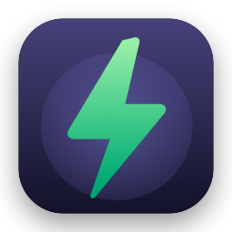

# Voltide for Mac

**Mac 版設備電量監測工具｜早期測試版**

[⬇️ 下載 Voltide for Mac 0.1.0 Beta（Apple 晶片）](https://github.com/eason1030715/Voltide-for-Mac/releases/download/v0.1.0-beta/Voltide-for-Mac-0.1.0-beta.zip)　·　[查看 Release 與更新說明](https://github.com/eason1030715/Voltide-for-Mac/releases/tag/v0.1.0-beta)

Voltide for Mac 是以 Swift 和 AppKit 製作的**非官方 macOS 改版**，根據 [Joko（sdparklab）及貢獻者的 Voltide](https://github.com/sdparklab/Voltide) 開發。原作版權歸原版權人所有，原始 MIT 授權與版權聲明保留在 [LICENSE](LICENSE)。此改版並非原作者發佈或背書。

## 下載與開啟

1. 下載上面的 ZIP 並解壓縮，開啟資料夾中的 **Voltide for Mac.app**。
2. 此測試版僅使用臨時簽章、**未經 Apple 公證**。如果 macOS 顯示無法驗證開發者，請先確認下載來源可信且檔案未遭竄改，再自行決定是否開啟。
3. 若決定開啟，在首次嘗試開啟後，進入 **系統設定 → 隱私權與安全性 → 安全性 → 強制打開**，依系統提示確認。按鈕通常在嘗試開啟後約一小時內顯示；不同地區可能顯示「仍要打開」。
4. 若系統提示 App 已損壞、遭竄改、含惡意軟體或會損壞電腦，請停止使用並重新確認檔案，不要強制打開。

詳見 [Apple：在 Mac 上安全地開啟 App](https://support.apple.com/zh-tw/102445)。

## 系統需求與目前支援

- **macOS 13 或以上，Apple 晶片（arm64）**。目前僅在一台 Apple 晶片 Mac mini 測試，最低版本並非所有版本皆已實測；Intel Mac 尚未支援或驗證。
- 已在該 Mac 上測試 Apple 藍牙鍵盤與滑鼠，以及透過 Logi Bolt 連線的 Logitech LIFT、Pebble Mouse 2 M350s。其他設備和連線方式尚未驗證。
- 可讀取 macOS 提供的部分 Apple 配件及 Mac 內建電池資訊，並查詢相容接收器的 Logitech HID++ 設備。**一般藍牙設備與原版的其他 2.4 GHz 接收器協定尚未完整移植。**
- 卡片依電量由高到低排列；電量相同時藍牙優先，滑鼠滾輪可橫向瀏覽。未滿電的卡片在滑鼠停留時會出現液面波動。

這仍是早期測試版：介面及功能尚未完全還原 Windows 原版；充電狀態尚無法可靠判定，顯示為休眠的設備也可能已斷線。並非所有藍牙或接收器設備都能顯示。

## 原始碼

Mac 程式碼、建置方式與詳細限制請見 [`macos/README.md`](macos/README.md)。原版 Windows 專案與說明保留在此 fork 中：[Windows 原版說明](README.windows.md)｜[原作者專案](https://github.com/sdparklab/Voltide)。

---

**English:** Voltide for Mac is an unofficial, incomplete macOS beta based on [Voltide by Joko and contributors](https://github.com/sdparklab/Voltide). [Download the Apple silicon beta](https://github.com/eason1030715/Voltide-for-Mac/releases/download/v0.1.0-beta/Voltide-for-Mac-0.1.0-beta.zip) or view the [release notes](https://github.com/eason1030715/Voltide-for-Mac/releases/tag/v0.1.0-beta). The beta is ad-hoc signed and not notarized. Supported devices and first-launch instructions are described in the [macOS README](macos/README.md). Original copyright and the MIT license remain in [LICENSE](LICENSE); this adaptation is not endorsed by upstream.
